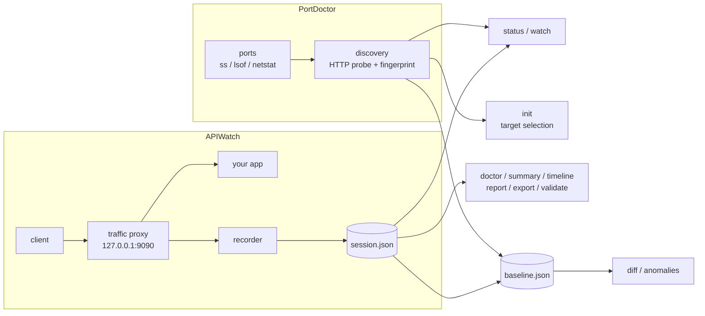

<div align="center">

# DevPulse

### Local development observability for the terminal

**Know what is running. See what is receiving traffic. Find what needs attention.**

[](https://github.com/yatinannam/devpulse/actions/workflows/ci.yml)
[](https://github.com/yatinannam/devpulse/actions/workflows/security.yml)
[](https://github.com/yatinannam/devpulse/actions/workflows/codeql.yml)
[](LICENSE)
[](https://github.com/yatinannam/devpulse/releases)

</div>

---

DevPulse is a single static Go binary (no cgo, no runtime dependencies) that gives you a live picture of your local development environment from the terminal. It combines two subsystems:

| Subsystem | Responsibility | Mechanism |
| --- | --- | --- |
| **PortDoctor** | Discover listening TCP sockets, owning processes, and which of them speak HTTP | Platform socket tables (`ss`, `lsof`, `netstat`) plus bounded HTTP probing |
| **APIWatch** | Capture request-level telemetry for your app | Loopback reverse proxy (`net/http/httputil`) that records every request into a versioned JSON session |

Everything downstream (`status`, `doctor`, `summary`, `timeline`, `baseline`, `diff`, `anomalies`, `report`, `export`) is a pure, deterministic function of those two data sources. DevPulse is **local-first**: it has no telemetry, uploads nothing, talks only to loopback and your configured target, and writes only to paths you control.

## Contents

- [Quick start](#quick-start)
- [Architecture](#architecture)
- [Command reference](#command-reference)
- [APIWatch: traffic capture](#apiwatch-traffic-capture)
- [PortDoctor: service discovery](#portdoctor-service-discovery)
- [Analysis engine](#analysis-engine)
- [Files, paths and configuration](#files-paths-and-configuration)
- [Installation](#installation)
- [Security model](#security-model)
- [Release engineering](#release-engineering)
- [Development](#development)
- [Known limitations](#known-limitations)
- [Roadmap](#roadmap)

---

## Quick start

```bash
cd my-project
devpulse init        # detect the project, find its HTTP server, save the target
devpulse traffic     # proxy 127.0.0.1:9090 -> your app; Ctrl+C saves the session
```

Point your browser or client at `http://127.0.0.1:9090`, exercise the app, then stop the proxy and inspect:

```bash
devpulse status      # services correlated with captured traffic
devpulse recent      # last 10 requests
devpulse doctor      # errors, slow requests, request loops
devpulse watch       # live dashboard, refreshed every 2s
```

`devpulse`, `devpulse help`, `-h` and `--help` print the command list. `devpulse version`, `--version` and `-v` print the build version.

---

## Architecture



### Package layout

| Package | Role |
| --- | --- |
| `cmd/devpulse` | CLI entry point. Flag parsing, command dispatch, exit codes, atomic file output |
| `internal/ports` | Per-OS listener enumeration (`ports_linux.go`, `ports_darwin.go`, `ports_windows.go`, `ports_stub.go`), pure parsers, port watch loop |
| `internal/discovery` | Concurrent HTTP probing of listeners and framework fingerprinting |
| `internal/project` | Project-type detection from marker files and HTTP target selection |
| `internal/traffic` | Reverse proxy, request recorder, session persistence |
| `internal/status` | Endpoint normalization, per-service aggregation, health classification |
| `internal/metrics` | Nearest-rank latency percentiles |
| `internal/doctor` | Profile-driven diagnostics (errors, slow requests, duplicate-request bursts) |
| `internal/summary` | Aggregate latency/error metrics and slowest requests |
| `internal/timeline` | Fixed-width chronological bucketing |
| `internal/baseline` | Versioned environment snapshots |
| `internal/diff` | Baseline-to-current change detection |
| `internal/anomaly` | Baseline regression rules (error rate, latency) |
| `internal/sessioncheck` | Session schema and request-invariant validation |
| `internal/report` | Markdown and JSON report rendering |
| `internal/config` | Layered configuration loading and persistence |
| `internal/output` | Shared JSON encoding |

---

## Command reference

Every command takes **flags only**. Pass files with flags such as `--from`. A stray positional argument (for example `devpulse validate ./session.json`) is rejected with exit status 2; it is never silently ignored. Run `devpulse <command> --help` for the generated flag list.

### Discovery and capture

| Command | Flags (default) | Description |
| --- | --- | --- |
| `init` | | Detect the project type, probe local HTTP services, and save the best match as `target` in `./.devpulse/config.json` |
| `ports` | `--watch` (`false`) | List listening TCP ports with PID and process. `--watch` then prints `+`/`-` events every second |
| `traffic` | `--listen` (config), `--target` (config) | Run the recording proxy. `SIGINT`/`SIGTERM` saves the session and exits |
| `status` | `--from` (session) | Discovered services joined with captured traffic, per-endpoint stats and health |
| `watch` | `--interval` (config, `2s`), `--from` (session) | Re-render `status` on an interval |

### Analysis

| Command | Flags (default) | Description |
| --- | --- | --- |
| `recent` | `-n` (`10`), `--from`, `--json` | Most recent requests, newest first |
| `doctor` | `--profile` (`default`), `--from`, `--json` | Diagnostic findings. Profiles: `default`, `strict`, `permissive` |
| `summary` | `--slowest` (`5`), `--from`, `--json` | Totals, error rate, mean, p50/p95/p99, slowest requests |
| `timeline` | `--bucket` (`1m`), `--from`, `--json` | Request count, errors and mean latency per time bucket |
| `validate` | `--from`, `--json` | Check session schema and request invariants. Exit 1 when invalid |

### Baselines and change detection

| Command | Flags (default) | Description |
| --- | --- | --- |
| `baseline` | `--from` (session), `--to` (`./.devpulse/baseline.json`) | Snapshot discovered services plus normalized endpoint statistics |
| `diff` | `--from` (baseline), `--session`, `--json` | Changes between the baseline and the current environment |
| `anomalies` | `--baseline`, `--session`, `--json` | Regression findings: new or removed services, error-rate jumps, latency regressions |

### Reporting and export

| Command | Flags (default) | Description |
| --- | --- | --- |
| `report` | `--out` (`devpulse-report.md`), `--format` (`markdown`), `--title`, `--top` (`5`), `--from` | Shareable Markdown or JSON report. `--out -` writes to stdout |
| `export` | `--out` (`-`), `--method`, `--status`, `--path-prefix`, `--since`, `--until`, `--limit`, `--from` | Filtered CSV of individual requests. See the [CSV export guide](docs/traffic-csv-export.md) |
| `config` | `--target`, `--listen`, `--watch-interval` | Print, or update and print, the active configuration |

### Exit status

| Code | Meaning |
| ---: | --- |
| `0` | Success. `doctor` and `anomalies` also exit 0 when they report findings |
| `1` | Runtime failure (unreadable session, I/O error, discovery failure), or `validate` found an invalid session |
| `2` | Usage error: unknown command or flag, positional argument, invalid `--status`, `--since`, `--until`, `--profile`, `-n` or interval |

---

## APIWatch: traffic capture

```text
  client ──────► 127.0.0.1:9090 ──────► target (default http://localhost:3000)
                 │
                 │  traffic.Handler
                 │    stores per-request state (start time, client URI, record-once guard)
                 │    answers X-DevPulse-Probe itself (never forwarded)
                 │
                 │  httputil.ReverseProxy
                 │    ModifyResponse ─► wrap the body in a byte counter
                 │    body EOF/close ─► record status, latency, bytes (once)
                 │    ErrorHandler   ─► record 502, or 499 if the client cancelled (once)
                 ▼
            Recorder (mutex-guarded, keeps the newest 1000 requests)
                 │
                 │  SIGINT / SIGTERM
                 │    stop accepting, wait up to 5s for in-flight requests, then close
                 │    snapshot after shutdown, so in-flight requests are kept
                 │    a second Ctrl+C quits at once, without saving
                 ▼
            session.json (temp file + rename, mode 0600; exit 1 if the save fails)
```

Each captured request becomes one record:

| Field | Type | Source |
| --- | --- | --- |
| `time` | RFC 3339 timestamp | Proxy receive time |
| `method` | string | Request method |
| `path` | string | Client request URI, including the query string, before any `--target` path prefix |
| `status` | int | Upstream status; `502` if the upstream could not be reached, `499` if the client cancelled first |
| `latency` | int (ns) | Receive time until the response body finished streaming |
| `bytes` | int | Response body bytes actually streamed; `0` for `HEAD`, `204`, upgrades and errors |
| `targetHost`, `targetPort` | string, int | Parsed from `--target` |

Sessions are versioned (`"version": 1`); readers reject unknown versions. The full schema is in [docs/session-format.md](docs/session-format.md) and the validation rules are in [docs/session-validation.md](docs/session-validation.md). Run `devpulse validate` before consuming a session in automation.

```bash
devpulse traffic --target http://localhost:8080 --listen 127.0.0.1:9090
devpulse validate --from ./artifacts/session.json --json
devpulse report --from ./artifacts/session.json --out ./artifacts/traffic.md
devpulse export --status 500 --path-prefix /api/ --out ./artifacts/errors.csv
```

`--target` must be an `http://` or `https://` URL with a host. Anything else is rejected at startup with a hint, for example `invalid target "localhost:3000": include the scheme, for example http://localhost:3000`, instead of starting a proxy that fails every request.

Shutdown is bounded. On Ctrl+C or SIGTERM the proxy stops accepting connections and waits up to 5 seconds for in-flight requests, then closes whatever is still open (for example a server-sent event stream). The session is snapshotted after that, so requests that finished during the wait are saved. Pressing Ctrl+C a second time quits immediately without saving. `devpulse traffic` exits `1` if the session cannot be saved, or if the listener fails while running (it still saves what it captured). Clients get 10 seconds to send their request headers.

`report` and `export` write through a temporary file and an atomic rename, set mode `0600`, and refuse an `--out` that is the same file as `--from`. The check uses file identity (`os.SameFile`), so case variants, hard links and symlinks are caught too. See [docs/markdown-reports.md](docs/markdown-reports.md).

---

## PortDoctor: service discovery

### Listener enumeration

| OS | Command | Parsing notes |
| --- | --- | --- |
| Linux | `ss -ltnp` | Process name and PID from the `users:(("name",pid=N,...))` column. IPv4 and IPv6 rows for the same port and PID are merged |
| macOS | `lsof -nP -iTCP -sTCP:LISTEN -F pcn` | Field-mode output. Exit status 1 (no matches) is treated as an empty table. TCP4 and TCP6 descriptors for the same port and PID are merged |
| Windows | `netstat -ano`, `tasklist /FO CSV /NH` | Reads both the TCP and TCPv6 tables. Listeners are matched by their wildcard foreign address (`0.0.0.0:0` / `[::]:0`), not the localized `LISTENING` text. IPv4 and IPv6 rows for the same port and PID are merged |
| Other | | `ports_stub.go` returns an unsupported-platform error |

On every OS, a dual-stack server (for example `0.0.0.0:22` plus `[::]:22`) is listed and probed once. Two different processes on the same port stay separate.

The netstat, tasklist, ss and lsof parsers are pure functions in untagged files, with fixture tests that run on every CI platform.

`ports --watch` diffs consecutive snapshots keyed by port. A new PID on a port that stayed open, such as a restart by nodemon or air between two polls, is reported as the old process closing and the new one opening. A failed poll is printed with `(retrying)` and skipped, so only the first poll is fatal. Changes within one poll are printed in port order.

### HTTP probing and fingerprinting

Each listener is probed concurrently on the loopback interface:

1. TCP dial to `127.0.0.1:<port>` with a 250 to 300 ms timeout. If that fails, dial `[::1]:<port>`, which catches servers bound only to IPv6 loopback (Vite binds `localhost` there on Node 17+). If both fail, the listener is non-HTTP. Later steps and the service URL (`http://127.0.0.1:3000` or `http://[::1]:5173`) use the address that answered.
2. `HEAD /`, with redirects not followed.
3. If the headers do not identify the server, `GET /` with `Accept: text/html,*/*;q=0.8` and the body capped at 8 KiB. Asking for HTML as a browser does makes Spring Boot return its Whitelabel Error Page instead of a JSON error.

Every probe carries `X-DevPulse-Probe: 1`. A running DevPulse proxy answers it with `204` and `X-DevPulse-Proxy: 1`, so discovery from `status`, `watch`, `init`, `baseline` and `diff` is never forwarded to your app or recorded in the session.

| Signal | Classified as |
| --- | --- |
| `X-DevPulse-Proxy` header | `DevPulse proxy` (never chosen by `init`) |
| `Server: uvicorn`, or body mentions `fastapi` | Python / FastAPI |
| `Server: gunicorn` | Python / Gunicorn |
| `Server` contains `next`, or body has `__NEXT_DATA__` / `_next/static` | Node / Next.js |
| `Server` contains `vite`, or body has `@vite` / `vite/client` | Node / Vite |
| `Server` or `X-Powered-By` contains `express` (stock Express sends only `X-Powered-By: Express`) | Node / Express |
| `Server` contains `jetty` / `tomcat`, an `X-Application-Context` header (Spring Boot 1.x), or body has `Whitelabel Error Page`. The word `spring` alone is not enough | Java / Spring |
| `Server` contains `caddy` / `nginx` | Caddy / Nginx |
| anything else that answers HTTP | HTTP service |

`status` joins captured requests to services by target port. Each port is shown once, even when several PIDs share it, so no request is counted twice. Endpoints are ordered by errors, average latency and request count, then by path and method, so `status` output and `baseline.json` are identical between runs over the same session.

`init` detects the project type from marker files (`next.config.{js,mjs,ts,cjs}`, `vite.config.{js,ts,mjs,mts,cjs,cts}`, `go.mod`, `pyproject.toml` / `requirements*.txt`, `pom.xml` / `build.gradle*`, `package.json`). It searches upward from the current directory for the nearest directory with a marker. The search stops at the repository root (the directory containing `.git`, which may be a file in worktrees and submodules) or at the filesystem root. That directory is the project root, and `init` writes `.devpulse/config.json` there, so running it from `src/` configures the whole project. With no marker, `init` reports `Unknown project` and writes to the current directory.

`init` then picks the target from the discovered HTTP services. The first rule that matches wins:

1. The conventional port for the project type: Next.js 3000, Vite 5173, Python 8000, Go/Java 8080.
2. The only HTTP service.
3. The first of 3000, 5173, 8000, 8080, 8081 and 9000 that is listening.
4. A service with an identified framework before a generic `HTTP service` (often an OS service such as HTTP.sys on Windows or AirTunes on macOS), then the lowest port.

---

## Analysis engine

All analysis is deterministic for a given session and never modifies it.

**Endpoint normalization** (`status`, `baseline`, `diff`, `anomalies`, and the `report` endpoint table) strips the query string and fragment, then replaces numeric and UUID path segments with `:id`. For example, `/users/42?tab=1` becomes `/users/:id`.

**Percentiles** use the nearest-rank method on a sorted copy: `p = sorted[ceil(q·n) − 1]`.

**Health** (`status`, `watch`): `error` if any request returned 4xx/5xx, `warning` if any took 500 ms or longer, otherwise `healthy`. Non-HTTP listeners show as `running`.

### Doctor profiles

| Profile | Slow request | Error status | Duplicate minimum | Duplicate window |
| --- | ---: | ---: | ---: | ---: |
| `default` | ≥ 500 ms | ≥ 400 | 3 | 3 s |
| `strict` | ≥ 250 ms | ≥ 400 | 2 | 5 s |
| `permissive` | ≥ 1 s | ≥ 500 | 4 | 2 s |

Duplicate detection groups requests by exact method and raw path, sorts each group by time, and slides the profile window across it. A finding fires when any single window contains at least the minimum. This catches sustained request loops and a burst followed by a late straggler; the finding reports the densest burst. Details are in [docs/diagnostic-profiles.md](docs/diagnostic-profiles.md).

### Diff kinds

`diff` compares the baseline with the current environment. Mean latencies are rounded to the nearest millisecond before they are compared and printed. Changes are sorted by kind, then subject, with port subjects in numeric order.

| Kind | Subject | Emitted when |
| --- | --- | --- |
| `endpoint-added` | `METHOD /path` | Endpoint seen now but absent from the baseline |
| `endpoint-changed` | `METHOD /path` | Request count, error count or mean latency differs |
| `endpoint-removed` | `METHOD /path` | Endpoint in the baseline but not seen now |
| `service-added` | `:port` | Port listening now but absent from the baseline |
| `service-changed` | `:port` | Same port, different service kind, or a different process name when both snapshots recorded one |
| `service-removed` | `:port` | Port in the baseline but no longer listening |
| `traffic-changed` | `traffic` | Total requests, errors or mean latency differs |

### Anomaly rules

| Kind | Severity | Condition |
| --- | --- | --- |
| `service-added` | info | Port listening now but absent from the baseline |
| `service-changed` | info | Same port, different service kind, or a different process name when both snapshots recorded one (as in `diff`) |
| `service-removed` | warning | Port in the baseline but no longer listening |
| `error-rate` | error | Current error rate ≥ 10 %, ≥ 2× the baseline rate, and ≥ 3 errors. A baseline with no requests counts as 0 % |
| `latency-regression` | warning | Endpoint mean latency ≥ 2× the baseline with ≥ 3 requests. Latencies print to about three significant digits, for example `900µs` or `12.3ms` |

Findings are sorted by severity (error, warning, info), then subject, with port subjects in numeric order.

### Timeline

Requests are grouped into buckets of `--bucket` width, aligned to the local wall clock: each request's instant is shifted by its local UTC offset, truncated with `time.Truncate`, and shifted back, so `--bucket 1h` starts on the local hour even at a +05:30 offset. Buckets are keyed by instant, so equal instants always share a bucket whatever their zone offset. Requests without a timestamp (zero time) are skipped.

---

## Files, paths and configuration

| File | Default location | Override |
| --- | --- | --- |
| Session | `~/.devpulse/session.json` | `DEVPULSE_SESSION`, or `--from` per command |
| Configuration | see precedence below | `DEVPULSE_CONFIG` |
| Baseline | `./.devpulse/baseline.json` | `--to` / `--from` / `--baseline` |

Configuration is resolved from the first source that exists:

1. `$DEVPULSE_CONFIG`
2. The nearest `.devpulse/config.json`, searching from the current directory up to the filesystem root (written by `devpulse init`)
3. `~/.devpulse/config.json`

| Key | Default | Notes |
| --- | --- | --- |
| `listen` | `127.0.0.1:9090` | Loopback only. Use `0.0.0.0:9090` to expose the proxy deliberately |
| `target` | `http://localhost:3000` | Must include the scheme |
| `watch_interval` | `2s` | Positive Go duration such as `500ms` or `5s` |

```bash
devpulse config                                 # print the active file and values
devpulse config --target http://localhost:8080
devpulse config --listen 127.0.0.1:9090
devpulse config --watch-interval 5s             # 0s, -1s or abc are rejected (exit 2)
```

Configuration files saved by versions before the loopback default may still contain `"listen": ":9090"` (all interfaces). Run `devpulse config --listen 127.0.0.1:9090` to update them. A malformed `watch_interval` in an existing file is reported on stderr and replaced by `2s` at runtime.

---

## Installation

### Prebuilt binaries

Download the archive for your platform from [GitHub Releases](https://github.com/yatinannam/devpulse/releases), extract `devpulse` (`devpulse.exe` on Windows), and put it on your `PATH`. Check it against `checksums.txt`, whose build provenance is attested by GitHub:

```bash
sha256sum --check --ignore-missing checksums.txt
gh attestation verify checksums.txt --repo yatinannam/devpulse
devpulse --version
```

### From source

Requires Go 1.22 or later. CI and releases use Go 1.27.3.

```bash
git clone https://github.com/yatinannam/devpulse.git
cd devpulse
CGO_ENABLED=0 go build -trimpath -o devpulse ./cmd/devpulse
```

---

## Security model

- **Loopback by default.** The proxy binds `127.0.0.1`, so neither the proxied app nor the recorder is reachable from the network unless you pass a wider `--listen`.
- **No egress.** DevPulse connects only to `127.0.0.1` (probes) and your configured `--target`.
- **Private artifacts.** Sessions, reports, exports and baselines are written with mode `0600` through a temporary file and an atomic rename, so a crash never leaves a half-written file in place. Configuration files are also written with mode `0600`.
- **Source protection.** `report` and `export` refuse to overwrite their input session (file-identity check).
- **Sensitive data.** Sessions store request paths, including query strings, and may contain tokens or identifiers. Treat them as local diagnostics and review them before sharing. Nothing is redacted automatically.

### Supply chain

```text
                     pull request / push
                              │
           ┌──────────────────┼──────────────────┐
           ▼                  ▼                  ▼
         Go CI            Security            CodeQL
     test + vet on      govulncheck +     static analysis
     linux/win/mac      go test -race
           │                  │                  │
           └──────────────────┼──────────────────┘
                              ▼
                      dependency review
                              │
                              ▼
                 Dependabot (gomod, actions)
```

---

## Release engineering

Pushing a `v*.*.*` tag runs `.github/workflows/release.yml`:

```text
  tag v1.2.3
      │
      ▼
  go test ./...  (Go 1.27.3)
      │
      ▼
  GoReleaser v2  ─►  CGO_ENABLED=0, ldflags -s -w -X main.version
      │
      ├─►  linux   amd64 · arm64   tar.gz
      ├─►  darwin  amd64 · arm64   tar.gz
      ├─►  windows amd64 · arm64   zip
      │
      ▼
  checksums.txt  ─►  actions/attest-build-provenance (OIDC, SLSA provenance)
```

---

## Development

```bash
go build ./...
go vet ./...
go test ./...
go test -race ./...          # needs cgo / a C toolchain
govulncheck ./...
GOOS=darwin go vet ./...     # vet another platform's build-tagged files
```

Guidelines:

- **Test first.** Every bug fix lands with a test that failed before the fix.
- **Keep OS code thin.** Put parsing in untagged pure functions so it is tested on every CI platform. Only the `exec.Command` call belongs in a `*_<goos>.go` file.
- **Keep output deterministic.** Sort anything derived from map iteration before printing or serializing.
- **Commit style.** Conventional commits: `fix(scope): …`, `feat(scope): …`, `docs(scope): …`, `ci(scope): …`.

---

## Known limitations

| Area | Current behavior |
| --- | --- |
| Recorder | Keeps only the newest 1000 requests per capture |
| Latency | Measured to upstream response headers. Body transfer time is excluded |
| Bytes | Taken from `Content-Length`. `-1` for chunked or compressed responses of unknown length |
| Shutdown | Waits for in-flight requests without a deadline. Long-lived streams (SSE) can delay exit |
| Target | `--target` must include a scheme (`http://`). A bare `host:port` is not rejected yet |
| JSON | Some empty collections serialize as `null` rather than `[]` |
| Probing | Probes use `127.0.0.1`. Services bound only to `::1` or a LAN address are listed but not identified as HTTP |

---

## Roadmap

### v0.2: local change intelligence

```text
endpoint normalization ─► baseline ─► change detection ─► anomaly detection
                                                                  │
                                                                  ▼
                 actionable diagnosis ◄── timeline ◄── dependency correlation
```

The goal is to answer a more useful question than *"what is running?"*:

> **What changed in my local environment, and what did that change affect?**

---

## Contributing

Issues and pull requests are welcome.

```bash
git checkout -b fix/<name>
go test ./... && go vet ./...
git commit -m "fix(scope): describe the change"
```

Keep changes focused, tested and platform-aware.

## License

[MIT](LICENSE)
